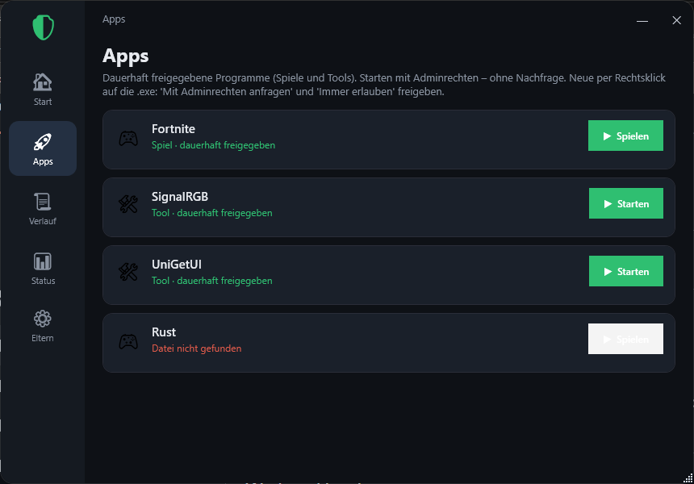

# RunAsAdmin

Kontrollierte, protokollierte **Adminrechte für Standardbenutzer** unter Windows 11 –
ein selbstgebauter Ersatz für Tools wie „Admin By Request". Gedacht für Kinder-PCs:
Die Kinder bleiben normale Benutzer, können aber gezielt und protokolliert zu
Adminrechten kommen. Freigaben laufen über **Home Assistant** (per Handy) oder über
das mitgelieferte **HA-Add-on**, alternativ lokal per **Eltern-PIN**.

Es gibt zwei Wege, die sich ergänzen:

- **Spiele dauerhaft freigeben** (für den Alltag): Ein Spiel (z. B. mit Anti-Cheat,
  oder SignalRGB) wird **einmalig** freigegeben und startet danach immer selbst
  erhöht – **ohne UAC, ohne dass das Kind Admin wird, ohne tägliches Nachfragen**.
  Technisch über eine geplante Aufgabe (Task Scheduler), die genau diese `.exe`
  erhöht startet.
- **Adminrechte auf Zeit** (für Ausnahmen, z. B. mal etwas installieren): Das Kind
  fragt **15 Minuten Admin** an, ein Elternteil gibt frei, danach automatischer
  Entzug. Protokolliert, welche Programme in der Zeit erhöht liefen.



Die App auf dem Kinder-PC: Seitenleiste (Start · Apps · Verlauf · Status · Eltern).
Hier der Reiter „Apps" – dauerhaft freigegebene Programme (Spiele und Tools) startet
das Kind per Klick erhöht, ohne UAC und ohne Admin zu werden.

---

## Freigabe-Wege im Überblick

| Weg | Wofür | Wie freigegeben |
|-----|-------|-----------------|
| **App dauerhaft** | tägliche Spiele / Tools mit Admin-Bedarf | einmalig „Immer erlauben" → Reiter *Apps* + Tray |
| **15 Min Admin** | einmalige Ausnahmen (installieren usw.) | pro Anfrage per Handy / Dashboard / PIN |

### Anbindung (umschaltbar in den Einstellungen)

- **Home Assistant** (Webhooks): Anfrage geht per Webhook an HA, Push mit
  *Erlauben / Ablehnen*, Entscheidung kommt an den PC zurück. Braucht ein
  gemeinsames Geheimnis (siehe unten).
- **Server** (HA-Add-on `runasadmin_server`): Der PC spricht mit **einem** Add-on,
  das Freigaben, Verlauf und ein Web-Dashboard (Graphen) bereitstellt. Der PC pollt
  nur ausgehend – **kein offener Port am PC nötig**.
- **Lokale Eltern-PIN**: Fallback, wenn HA/Server nicht erreichbar ist. Papa gibt am
  PC die PIN ein → sofort 15 Minuten Admin. Falsche PIN wird gemeldet.

---

## Ablauf: Spiel dauerhaft freigeben

1. Kind: Rechtsklick auf die Spiel-`.exe` → **„Mit Adminrechten anfragen"**.
2. Elternteil gibt frei und wählt **„Immer erlauben"** (per Handy, Dashboard oder PIN).
3. Der Dienst legt für dieses Spiel eine **geplante Aufgabe** an (läuft als der
   angemeldete Benutzer mit höchsten Rechten) und sichert die Datei per
   **Hash/Herausgeber** gegen Austausch ab.
4. Das Programm erscheint im Reiter **„Apps"** (als Spiel oder Tool) und im
   **Tray-Menü**. Ab jetzt startet das Kind es dort per Klick – erhöht, ohne UAC, nur
   dieses eine Programm.

## Ablauf: Adminrechte auf Zeit (15 Min)

1. Kind klickt in der App **„Adminrechte anfragen (15 Min)"**.
2. Freigabe per Handy (HA), im Add-on-Dashboard oder lokal per **Eltern-PIN**.
3. Bei *Erlauben* nimmt der Dienst (SYSTEM) das Kind kurz in die lokale
   Administratorengruppe; Tray-Symbol wird grün, Restzeit läuft.
4. Das Kind startet seine Programme selbst. Protokolliert wird, was **tatsächlich
   erhöht** lief.
5. Nach 15 Minuten: automatischer Entzug. Not-Aus jederzeit per Handy/Dashboard.

---

## Bestandteile

| Teil | Projekt | Läuft wo |
|------|---------|----------|
| **Dienst** (Anfragen, Admin-Zeit, Spiele-Start, Protokoll) | `src/RunAsAdmin.Service` | als SYSTEM auf jedem Kinder-PC |
| **GUI** (Tray + Fenster: Start, Apps, Verlauf, Status, Eltern) | `src/RunAsAdmin.Gui` | als das Kind auf dem Kinder-PC |
| **Installer** (Single-File-Setup, Deinstaller, Cleanup) | `src/RunAsAdmin.Installer` | einmal pro PC |
| Gemeinsames Modell, Verschlüsselung, Update | `src/RunAsAdmin.Shared` | – |
| **Home Assistant** (Automationen, Dashboard) | `homeassistant/` | dein HA-Server |
| **HA-Add-on** (Server-Modus: API + Dashboard) | `addon/runasadmin-server/`¹ | dein HA-Server |

¹ Das Add-on wird aus dem Repo **`Delido/hassio-addons`** installiert; `addon/` hier ist die Entwicklungsquelle.

---

## Installation (pro Kinder-PC)

Die Release-Dateien sind **self-contained** – es ist **kein** .NET nötig.

1. Aktuelles **`RunAsAdmin-Setup.zip`** von den
   [Releases](https://github.com/Delido/makemeadmin/releases) herunterladen und
   entpacken.
2. **`RunAsAdmin-Setup.exe`** (auf der obersten Ebene) als Administrator ausführen.
   Der Installer kopiert die Dateien, härtet die Berechtigungen (Kinder können
   Konfiguration und Protokolle nicht ändern), legt das Tray-Autostart an,
   registriert den Dienst als LocalSystem und – **nur im HA-Modus** – setzt
   URL-Vorbehalte + Firewallregeln für den Rückkanal.
3. **Einrichten (einmalig):** Tray-Symbol → *Einstellungen (Eltern)*:
   - **Verbindungsart** wählen: *Home Assistant* oder *Server*.
   - *Home Assistant:* Adresse + **gemeinsames Geheimnis** (siehe unten) eintragen,
     „Home Assistant verwenden" anhaken.
   - *Server:* Add-on-Adresse (`http://<ha-ip>:8099`) + **Server-Token** eintragen
     (= die Add-on-Option `pc_token`).
   - In beiden Fällen eine **Eltern-PIN** festlegen.

> Bei Problemen mit einer alten Installation: `Cleanup.ps1` (im ZIP) als Admin
> ausführen, ggf. neu starten, dann Setup erneut.

**Updates:** Die App prüft stündlich selbst auf neue Releases und spielt sie ein
(nicht während einer aktiven Admin-Zeit). Manuell: in der App unter *Status* →
„Nach Updates suchen".

---

## Das gemeinsame Geheimnis / Token

Je nach Verbindungsart brauchst du **einen** Wert – und er muss auf beiden Seiten
identisch sein:

- **Home Assistant (CallbackSecret):** ein **frei erfundenes** Passwort. Du trägst
  denselben Wert am PC (GUI) **und** in Home Assistant ein. Damit prüft der PC, dass
  die Freigabe-Antwort wirklich von deinem HA kommt. In der GUI erzeugt der Knopf
  **„Würfeln"** auf Wunsch ein starkes Zufalls-Secret und kopiert es.
- **Server (pc_token):** das Token kommt **vom Add-on**. In HA beim Add-on
  „RunAsAdmin Server" unter *Konfiguration* die Option `pc_token` setzen und denselben
  Wert am PC eintragen.

Beide Werte werden am PC mit Windows **DPAPI** verschlüsselt gespeichert, nie im
Klartext – auch nicht in der Konfigurationsdatei.

---

## Sicherheit

- **Geheimnisse verschlüsselt:** Secret/Token per **DPAPI** verschlüsselt, Eltern-PIN
  als gesalzener Hash. Änderbar nur über die PIN-geschützten Einstellungen.
- **Dieses Repo enthält keine persönlichen Daten** – keine HA-Adresse, kein Secret.
- **Gehärtete Rechte:** Konfiguration (`C:\ProgramData\RunAsAdmin\config.json`) und
  Protokolle sind per ACL für die Kinder gesperrt.
- **Spiele-Start abgesichert:** Vor jedem Start wird die `.exe` gegen den hinterlegten
  Hash/Herausgeber geprüft – eine ausgetauschte Datei startet nicht.
- **Zeitlich begrenzt:** 15-Min-Rechte werden automatisch entzogen – auch nach einem
  Dienst-Neustart wird eine verwaiste Mitgliedschaft aufgeräumt. Not-Aus per Handy/
  Dashboard.
- Im HA-Modus sind die lokalen Listener per Firewallregel beschränkt; im Server-Modus
  gibt es keinen eingehenden Port.

---

## Home Assistant (HA-Modus)

Im Ordner `homeassistant/`:

1. **`configuration.snippet.yaml`** → `rest_command`, `input_text`-Helfer und
   `counter` übernehmen → **HA neu starten**.
2. **`automation.yaml`** → Automationen in `automations.yaml` übernehmen und
   `notify.mobile_app_DEIN_HANDY` auf dein Gerät setzen → Automationen neu laden.
3. **`dashboard.yaml`** → als neues Dashboard über den Raw-Editor einfügen.

Anfragen kommen per Webhook rein (nur Heimnetz, `local_only: true`), die Push bietet
*Erlauben / Ablehnen*, die Entscheidung geht an den Rückkanal des PCs zurück.

## HA-Add-on (Server-Modus)

Das Add-on **„RunAsAdmin Server"** (Repo `Delido/hassio-addons`) bietet eine zentrale
API für die PCs und ein Web-Dashboard: offene Anfragen mit *Erlauben/Ablehnen*,
aktive Admin-Zeiten mit Not-Aus, Admin-Zeiten pro Tag, meistgespielte Spiele und die
je PC freigegebenen Spiele.

1. In HA → Add-on-Store → ⋮ → *Repositories* → `https://github.com/Delido/hassio-addons`.
2. „RunAsAdmin Server" installieren, `pc_token` setzen, starten.
3. Am PC in den Einstellungen Verbindungsart *Server* wählen und Adresse + Token eintragen.

---

## Protokoll ansehen

- **Lokal (fälschungssicher):** `C:\ProgramData\RunAsAdmin\logs\audit-JJJJ-MM-TT.jsonl`
  (eine JSON-Zeile je Ereignis) + Windows-Ereignisanzeige (Quelle `RunAsAdmin`).
- **In Home Assistant / Add-on:** Logbuch bzw. Dashboard.

Wichtige Ereignisse: `timeadmin.granted` / `timeadmin.revoked` (mit Programmliste),
`timeadmin.denied`, `game.launched`, `games.registered`, `settings.saved`, `update.*`.

---

## Selbst bauen

Voraussetzung: .NET 8 SDK.

```powershell
.\install\Publish.ps1    # baut Service/GUI/Installer self-contained nach .\publish
```

Die Versionsnummer wird zentral in `Directory.Build.props` gepflegt (gilt für alle
Projekte, damit die Dateiversion jeder exe zum Release passt).

---

## Hinweise / Grenzen

- Der **Task-Scheduler-Start** für Spiele ist der zuverlässige Weg, erhöht und
  sichtbar zu starten. Ob ein bestimmter Anti-Cheat einen so gestarteten Prozess
  akzeptiert, kann je nach Spiel variieren.
- Bei **Microsoft-Konten** kann der Kontoname für die geplante Aufgabe abweichen –
  wird im Protokoll sichtbar, falls das Anlegen fehlschlägt.
- Die „erhöht gelaufen?"-Erkennung fängt Programme mit Admin-Token; je nach
  Spiel/Launcher kann die Liste nachjustiert werden.
